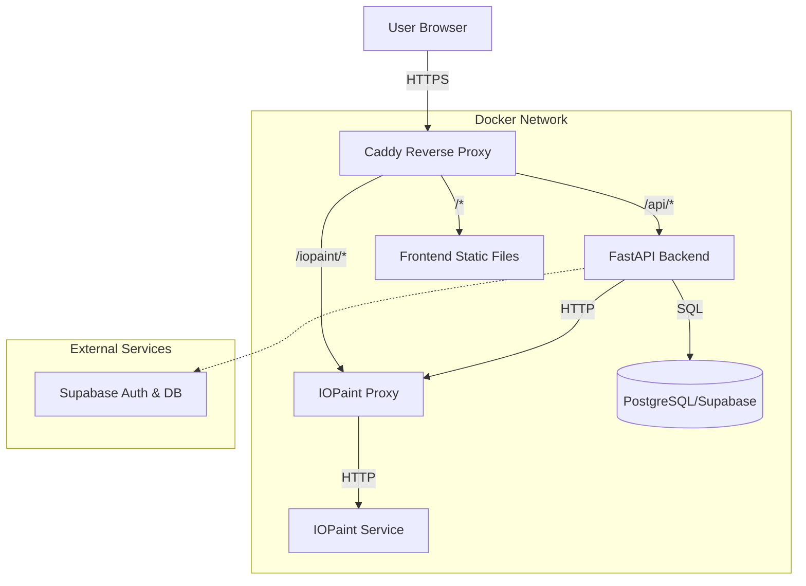

# ClearMark Architecture Documentation

## 1. System Overview

ClearMark is a web-based AI watermark removal platform. It allows users to upload images, draw masks over watermarks, and use AI (IOPaint) to remove them. The system also includes user authentication and a blog management system.

The application follows a **containerized microservices** architecture, orchestrated via Docker Compose.

### High-Level Architecture

## 2. Technology Stack

| Component | Technology | Description |
|-----------|------------|-------------|
| **Frontend** | HTML5, CSS3, Vanilla JS | Lightweight, no-framework frontend. |
| **Backend** | Python, FastAPI | High-performance async API. |
| **Database** | PostgreSQL | Managed via Supabase or local Docker container. |
| **AI Engine** | IOPaint (PyTorch) | Inpainting tool using SOTA models (e.g., LaMa). |
| **Proxy** | Caddy | Web server, reverse proxy, and auto-HTTPS. |
| **Infra** | Docker, Docker Compose | Containerization and orchestration. |

## 3. Component Details

### 3.1 Frontend (`/frontend`)
*   **Type**: Static Web Application.
*   **Serving**: Served by Caddy (production) or local server (dev).
*   **Key Directories**:
    *   `js/`: Contains business logic.
        *   `mask-drawer.js`: Canvas logic for drawing masks on images.
        *   `watermark-removal.js`: Handles interaction with the AI service.
        *   `auth.js`: Manages user login/registration via Backend/Supabase.
    *   `css/`: Vanilla CSS styles.
    *   `components/`: Reusable HTML snippets (Header, Footer).

### 3.2 Backend (`/backend`)
*   **Type**: RESTful API.
*   **Framework**: FastAPI.
*   **Architecture**: 3-Layer Pattern.
    1.  **API Layer** (`api/routes`): Handles HTTP requests/responses.
    2.  **Service Layer** (`service/`): Contains business logic.
    3.  **Repository Layer** (`repository/`): Handles database interactions.
*   **Key Modules**:
    *   `main.py`: App entry point and CORS config.
    *   `api/routes/`:
        *   `auth.py`: User authentication.
        *   `posts.py`: Blog CRUD operations.
        *   `remove_background.py`: Image processing endpoints.
    *   `iopaint-proxy.py`: A specialized proxy script to interface with the IOPaint service.

### 3.3 AI Service (`iopaint`)
*   **Image**: Custom Docker image based on `backend` context.
*   **Function**: Runs the IOPaint model (LaMa) to perform image inpainting.
*   **Integration**:
    *   Runs on port `8080`.
    *   Accessed via `iopaint-proxy` (port `5001`) to handle request formatting or security.

### 3.4 Database
*   **Primary**: PostgreSQL.
*   **Management**: Supabase is the primary provider for Auth and DB.
*   **Local Fallback**: A local Postgres container is available for dev/debugging (`USE_LOCAL_DB=true`).
*   **Schema**: Managed via SQL migration scripts (`backend/supabase-migrations.sql`).

## 4. Data Flow: Watermark Removal

1.  **Upload**: User uploads an image to the Frontend.
2.  **Masking**: User draws a mask over the watermark using `mask-drawer.js`.
3.  **Request**: Frontend sends the original image and mask to the Backend (or directly to Proxy depending on implementation details).
4.  **Processing**:
    *   Backend/Proxy forwards the request to the IOPaint service.
    *   IOPaint processes the image using the loaded model (e.g., LaMa).
5.  **Response**: The processed image is returned to the Frontend for display/download.

## 5. Deployment & Configuration

*   **Docker Compose**: Defines the services (`frontend`, `backend`, `iopaint`, `iopaint-proxy`, `postgres`, `caddy`).
*   **Environment Variables**: Managed via `.env` file.
    *   `DATABASE_URL`: Connection string.
    *   `SUPABASE_*`: Supabase credentials.
    *   `IOPAINT_URL`: Internal URL for the AI service.
*   **Ports**:
    *   `3000`: Frontend
    *   `8000`: Backend API
    *   `8080`: IOPaint
    *   `80/443`: Caddy (Public Access)
