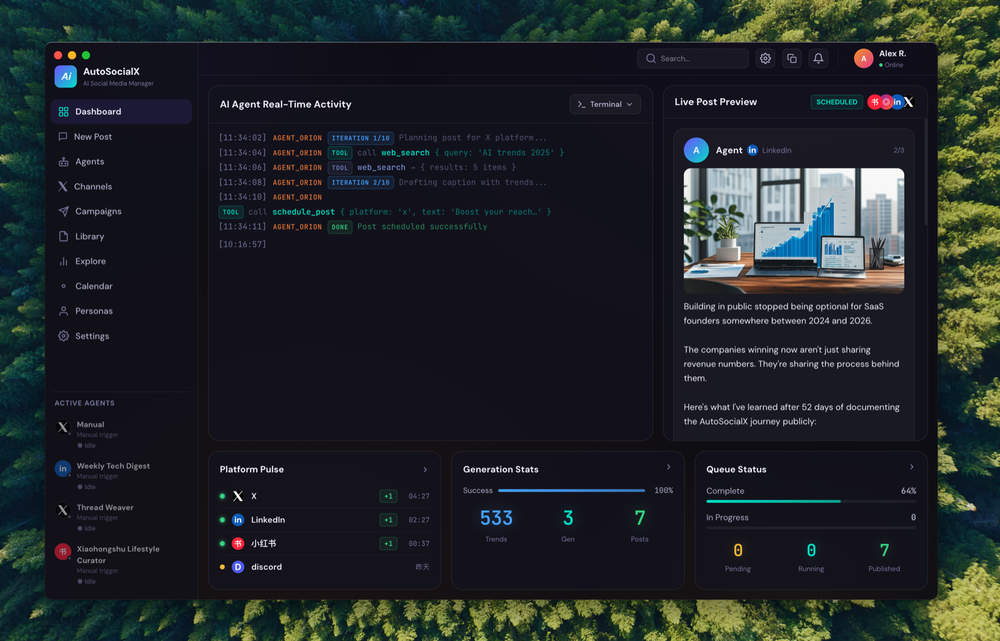

<div align="center">


<br/>


<br/>
<br/>

[English](README.md) · [中文](README_zh.md)

<br/>

[](LICENSE)
[](https://www.electronjs.org/)
[](https://react.dev/)
[](https://www.typescriptlang.org/)
[](https://pnpm.io/)

[](https://example.com/project-updates)
[](https://example.com/community)

</div>

---

## Your social media, on autopilot.

AutoSocialX is a desktop app that runs **AI agents 24/7** to fully manage your social media presence — researching trends, writing content, generating images, and publishing — all without you lifting a finger.

Configure your agents once. They run on a schedule, post across platforms, and keep your accounts active while you focus on everything else.

> All data stays **local** on your machine. No subscriptions, no cloud sync, no data leaving your device.

---

## How It Works

```
① You define agents & campaigns
        ↓
② Agents run on schedule (hourly / daily / custom cron)
        ↓
③ Each agent: searches the web · reads RSS · recalls memory
        ↓
④ Writes post · generates image · calls schedule_post
        ↓
⑤ AutoSocialX publishes via n8n → X, LinkedIn, Xiaohongshu, Instagram…
        ↓
⑥ Repeat — fully unattended
```

Set up once, runs forever. No manual posting, no copy-pasting, no missed schedules.

---

## Screenshots



---

## What You Can Automate

| | Capability | Detail |
|---|---|---|
| 🗓️ | **Scheduled posting** | Cron-based agents post on your exact schedule, every day |
| 📰 | **Trend research** | Agents search the web and read your RSS feeds before writing |
| ✍️ | **Content generation** | Platform-native writing: thread format for X, long-form for LinkedIn, hook-style for Xiaohongshu |
| 🖼️ | **Image generation** | Auto-create visuals via 302.ai Kling, DALL-E 3, or Flux |
| 📣 | **Multi-platform publishing** | One agent, 8 platforms — via n8n webhook |
| 🧠 | **Brand voice memory** | Agents remember past posts and your brand guidelines across runs |
| 📋 | **Campaign management** | Group agents into campaigns with shared goals and posting calendars |
| 🔁 | **Zero-touch operation** | No login required at runtime — agents run headlessly in the background |

---

## Quick Start

### Prerequisites

| Tool | Version |
|---|---|
| Node.js | ≥ 20 |
| pnpm | ≥ 9 |
| Docker | any *(for n8n — optional if you have your own)* |

### 1. Run the App

```bash
git clone https://github.com/your-org/autosocialx.git
cd autosocialx && pnpm install
cd apps/desktop && pnpm dev
```

### 2. Start n8n (Publishing Gateway)

```bash
cd n8n && docker-compose up -d
# Open http://localhost:5678 → import workflows from n8n/workflows/
```

Two ready-to-use workflows are included:
- `social_media_autopublish.json` — connectivity test (dry-run, no real posts)
- `social_media_autopublish_official.json` — production publishing (fill in your platform tokens)

### 3. Connect & Configure

In AutoSocialX **Settings**:
1. **AI Providers** — add an API key (Claude, OpenAI, DashScope, DeepSeek, or local Ollama)
2. **Publish API** — paste the n8n webhook URL
3. **Agents** — create your first agent, assign a platform and cron schedule

Your agent will start posting automatically on its next scheduled run.

---

## Supported LLM Providers

| Provider | Type |
|---|---|
| Anthropic Claude | Cloud |
| OpenAI | Cloud |
| DashScope · Bailian (Aliyun) | Cloud |
| DeepSeek | Cloud |
| Ollama · LM Studio | Local — fully offline |

---

## Supported Platforms

### ✅ Supported — via n8n Webhook

[-Supported-000000?style=flat-square&logo=x&logoColor=white)](https://x.com)
[](https://linkedin.com)
[](https://xiaohongshu.com)
[](https://instagram.com)
[](https://tiktok.com)
[](https://youtube.com)
[](https://facebook.com)
[](https://threads.net)

### 🚧 In Development

[](https://bsky.app)
[](https://pinterest.com)
[](https://weibo.com)
[](https://bilibili.com)
[](https://douyin.com)

> Custom channels can be added in **Settings → General**.

---

## Skills System

Skills are Markdown files with YAML frontmatter that shape how agents write for each platform. Drop a folder into the skills directory or install via **Settings → Skills**.

```markdown
---
name: generate_xhs_post
description: Xiaohongshu post with hook title, body, and hashtags
---

(prompt instructions here)
```

Built-in skills: `generate_xhs_post` · `generate_x_thread` · `generate_linkedin_article` · `viral_hook_writer` · `hashtag_analyze` · `translate` · and more.

---

## MCP Integration

Connect any [Model Context Protocol](https://modelcontextprotocol.io) server in **Settings → MCP** to extend agent capabilities with custom tools.

```json
{
  "name": "browser",
  "command": "npx",
  "args": ["@playwright/mcp@latest"]
}
```

---

## Architecture

```
Agent scheduler (cron)
  └─ triggers AgentCore
        └─ ReAct loop: Reason → Act → Observe (up to 30 iterations)
              ├─ web_search · rss_reader · image_gen · memory_recall
              └─ schedule_post → SQLite
                    └─ n8n webhook → platform APIs
```

See [`ARCHITECTURE.md`](docs/ARCHITECTURE.md) for the full module design.

---

## Project Structure

```
autosocialx/
├── apps/desktop/
│   ├── electron/          # Main process — agent runtime, LLM, DB, MCP
│   │   ├── agent-core/    # ReAct engine, LLM gateway, memory, tools
│   │   ├── agents/        # Registry, scheduler, content publisher
│   │   ├── db/            # SQLite migrations and stores
│   │   └── skills/        # Built-in SKILL.md bundles
│   └── src/               # Renderer — React pages, Zustand stores
├── n8n/                   # Docker Compose + ready-to-use workflow files
├── packages/              # Shared monorepo packages
└── docs/                  # Logo, screenshots, diagrams
```

---

## Contributing

1. Fork → create a feature branch
2. `pnpm dev` — verify the app starts
3. Make changes · run `npx tsc --noEmit`
4. Open a pull request and include a clear description of the change.

---

## Community & Contact

- **Project updates**: [example.com/project-updates](https://example.com/project-updates)
- **Community**: [Join the example community](https://example.com/community)

---

## License

[MIT](LICENSE) © 2025 AutoSocialX contributors
