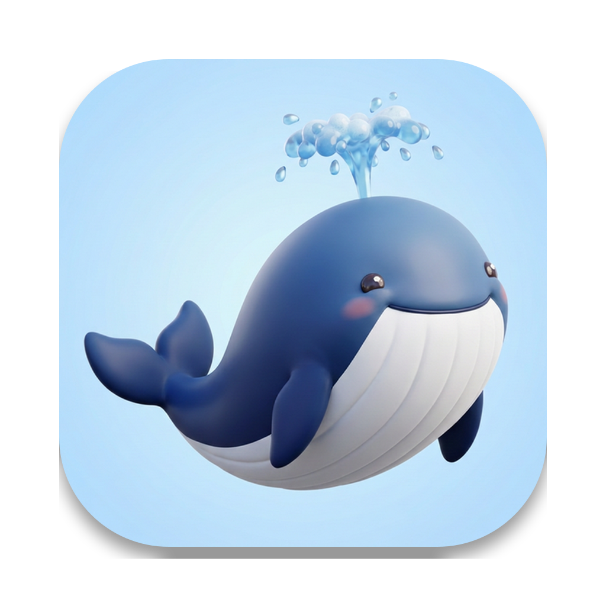
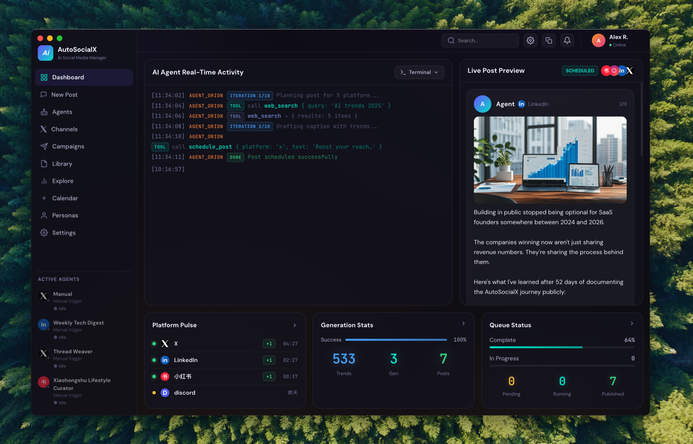

<div align="center">



<br/>


<br/>
<br/>

[English](README.md) · [中文](README_zh.md)

<br/>

[](LICENSE)
[](https://www.electronjs.org/)
[](https://react.dev/)
[](https://www.typescriptlang.org/)
[](https://pnpm.io/)

[](https://example.com/project-updates)
[](https://example.com/community)

</div>

---

## 你的社交媒体，全自动托管。

AutoSocialX 是一款桌面应用，让 **AI Agent 7×24 小时**全权接管你的社媒运营——自动调研热点、撰写内容、生成配图、定时发布，全程无需人工干预。

配置好 Agent，它就会按计划持续运转，账号保持活跃，你专注自己的事。

> 所有数据**仅存储在本地**。无订阅费，无云同步，数据不离开你的设备。

---

## 运作方式

```
① 你配置好 Agent 和内容计划
        ↓
② Agent 按 Cron 计划自动触发（每小时 / 每天 / 自定义）
        ↓
③ 自动联网搜索 · 读取 RSS · 召回记忆
        ↓
④ 撰写帖子 · 生成配图 · 调用 schedule_post
        ↓
⑤ AutoSocialX 通过 n8n 发布到 X、领英、小红书、Instagram……
        ↓
⑥ 循环往复，完全无人值守
```

一次配置，持续运转。不用手动发帖，不用复制粘贴，不再错过任何发布时间。

---

## 截图



---

## 可以自动化的事

| | 能力 | 说明 |
|---|---|---|
| 🗓️ | **定时发帖** | 基于 Cron 的 Agent，按你设定的时间表每天自动发布 |
| 📰 | **热点调研** | 发帖前自动联网搜索 + 读取 RSS，内容跟上最新动态 |
| ✍️ | **内容创作** | 适配各平台风格：X 用 Thread 格式，领英写长文，小红书用钩子标题 |
| 🖼️ | **配图生成** | 通过 302.ai Kling、DALL-E 3 或 Flux 自动生成配图 |
| 📣 | **多平台发布** | 一个 Agent，同时覆盖 8 个平台，通过 n8n webhook 统一分发 |
| 🧠 | **品牌记忆** | Agent 跨次运行记住历史帖子和品牌风格，保持一致性 |
| 📋 | **活动管理** | 将多个 Agent 组织成 Campaign，共享目标和发布日历 |
| 🔁 | **零干预运行** | 运行时无需登录，Agent 在后台静默执行 |

---

## 快速上手

### 环境要求

| 工具 | 版本 |
|---|---|
| Node.js | ≥ 20 |
| pnpm | ≥ 9 |
| Docker | 任意版本 *（用于 n8n，已有自建 n8n 可跳过）* |

### 1. 启动应用

```bash
git clone https://github.com/your-org/autosocialx.git
cd autosocialx && pnpm install
cd apps/desktop && pnpm dev
```

### 2. 启动 n8n（发布网关）

```bash
cd n8n && docker-compose up -d
# 浏览器打开 http://localhost:5678，导入 n8n/workflows/ 中的工作流
```

已内置两个工作流，直接导入即用：
- `social_media_autopublish.json` — 连通性测试（空跑，不会真实发布）
- `social_media_autopublish_official.json` — 正式发布（填入各平台 Token 后启用）

### 3. 连接与配置

在 AutoSocialX **Settings** 中完成三步：
1. **AI Providers** — 添加 API Key（Claude、OpenAI、DashScope、DeepSeek 或本地 Ollama 均可）
2. **Publish API** — 填入 n8n Webhook URL
3. **Agents** — 创建第一个 Agent，指定平台和 Cron 时间表

Agent 将在下一个计划时间自动开始发布。

---

## 支持的 LLM 提供商

| 提供商 | 类型 |
|---|---|
| Anthropic Claude | 云端 |
| OpenAI | 云端 |
| 阿里云 DashScope · 百炼 | 云端 |
| DeepSeek | 云端 |
| Ollama · LM Studio | 本地 — 完全离线 |

---

## 支持的平台

### ✅ 已支持 — 通过 n8n Webhook

[-已支持-000000?style=flat-square&logo=x&logoColor=white)](https://x.com)
[](https://linkedin.com)
[](https://xiaohongshu.com)
[](https://instagram.com)
[](https://tiktok.com)
[](https://youtube.com)
[](https://facebook.com)
[](https://threads.net)

### 🚧 开发中

[](https://bsky.app)
[](https://pinterest.com)
[](https://weibo.com)
[](https://bilibili.com)
[](https://douyin.com)

> 自定义平台随时可在 **Settings → General** 中添加。

---

## Skills 系统

Skills 是带 YAML 头信息的 Markdown 文件，决定 Agent 针对各平台的写作风格。拖入 Skills 目录或在 **Settings → Skills** 中一键安装。

```markdown
---
name: generate_xhs_post
description: 生成小红书笔记（标题、正文、话题标签）
---

（此处填写提示词指令）
```

内置 Skills：`generate_xhs_post` · `generate_x_thread` · `generate_linkedin_article` · `viral_hook_writer` · `hashtag_analyze` · `translate` 等。

---

## MCP 集成

在 **Settings → MCP** 中接入任意 [Model Context Protocol](https://modelcontextprotocol.io) 服务器，为 Agent 扩展自定义工具能力。

```json
{
  "name": "browser",
  "command": "npx",
  "args": ["@playwright/mcp@latest"]
}
```

---

## 架构概览

```
Agent 调度器（Cron）
  └─ 触发 AgentCore
        └─ ReAct 循环：推理 → 行动 → 观察（最多 30 轮）
              ├─ web_search · rss_reader · image_gen · memory_recall
              └─ schedule_post → SQLite
                    └─ n8n webhook → 各平台 API
```

详细模块设计见 [`ARCHITECTURE.md`](docs/ARCHITECTURE.md)。

---

## 目录结构

```
autosocialx/
├── apps/desktop/
│   ├── electron/          # 主进程 — Agent 运行时、LLM、数据库、MCP
│   │   ├── agent-core/    # ReAct 引擎、LLM 网关、记忆、工具
│   │   ├── agents/        # 注册表、调度器、内容自动发布
│   │   ├── db/            # SQLite 迁移和数据存取
│   │   └── skills/        # 内置 SKILL.md 包
│   └── src/               # 渲染进程 — React 页面、Zustand Store
├── n8n/                   # Docker Compose + 内置工作流文件
├── packages/              # Monorepo 共享包
└── docs/                  # Logo、截图、架构图
```

---

## 参与贡献

1. Fork 仓库 → 创建 feature 分支
2. `pnpm dev` 验证启动正常
3. 修改代码 · 运行 `npx tsc --noEmit` 确认类型正确
4. 提交 Pull Request，描述清楚改动内容

---

## 社区与交流

- **项目动态**：[example.com/project-updates](https://example.com/project-updates)
- **示例社区**：[加入讨论与反馈](https://example.com/community)

---

## 许可证

[MIT](LICENSE) © 2025 AutoSocialX contributors
